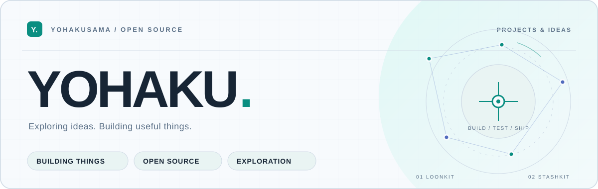
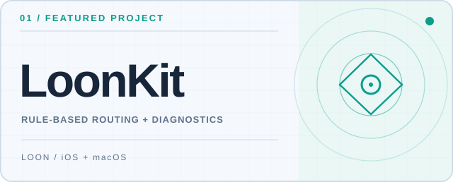
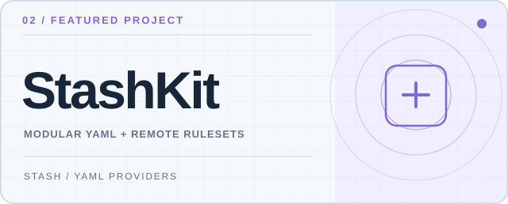

<!--
  YohakuSama / GitHub profile
  Self-hosted SVG assets. No third-party statistics services or visitor counters.
  Place this file at the root of the public YohakuSama/YohakuSama repository.
-->

  <picture>
    <source media="(max-width: 600px) and (prefers-color-scheme: dark)" srcset="./assets/hero-mobile-dark.svg" />
    <source media="(max-width: 600px)" srcset="./assets/hero-mobile-light.svg" />
    <source media="(prefers-color-scheme: dark)" srcset="./assets/hero-dark.svg" />
    
  </picture>

 

  <h3>你好，我是余白。 / Hi, I'm Yohaku.</h3>
  
专注网络分流、规则设计、DNS 诊断与自动化配置。 
  Building maintainable network configurations and tools for Loon &amp; Stash.

  

    <a href="https://github.com/YohakuSama/loonkit">LoonKit</a>
    &nbsp; · &nbsp;
    <a href="https://github.com/YohakuSama/stashkit">StashKit</a>
    &nbsp; · &nbsp;
    <a href="https://github.com/YohakuSama?tab=repositories">All repositories</a>
  

 

### Selected work / 精选项目

<table>
  <tr>
    <td width="50%" valign="top">
      <a href="https://github.com/YohakuSama/loonkit">
        <picture>
          <source media="(prefers-color-scheme: dark)" srcset="./assets/loonkit-dark.svg" />
          
        </picture>
      </a>
      
面向 Loon 的规则分流配置与网络辅助工具。按服务管理策略组，提供节点选路、出口检查和 DNS 诊断。

      

        <a href="https://github.com/YohakuSama/loonkit#快速开始">快速开始</a> ·
        <a href="https://github.com/YohakuSama/loonkit/tree/main/docs">文档</a> ·
        <a href="https://github.com/YohakuSama/loonkit/releases">版本</a>
      

    </td>
    <td width="50%" valign="top">
      <a href="https://github.com/YohakuSama/stashkit">
        <picture>
          <source media="(prefers-color-scheme: dark)" srcset="./assets/stashkit-dark.svg" />
          
        </picture>
      </a>
      
面向 Stash 的模块化 YAML 配置。以远程规则集组织服务分流，保留清晰的策略优先级与可追踪的更新流程。

      

        <a href="https://github.com/YohakuSama/stashkit#快速开始">快速开始</a> ·
        <a href="https://github.com/YohakuSama/stashkit/tree/main/docs">文档</a> ·
        <a href="https://github.com/YohakuSama/stashkit/releases">版本</a>
      

    </td>
  </tr>
</table>

### What I work on / 关注方向

<table>
  <tr>
    <td width="33%" valign="top"><strong>01 / Routing</strong> 按 AI、开发平台、流媒体和其他场景组织分流规则，控制规则优先级。</td>
    <td width="33%" valign="top"><strong>02 / Diagnostics</strong> 检查 DNS、节点可用性、连接状态与实际出口，辅助排查网络问题。</td>
    <td width="33%" valign="top"><strong>03 / Reproducibility</strong> 借助版本记录、固定规则快照与 CI，维护可审查的配置变更。</td>
  </tr>
</table>

### Tools & workflow / 工具与工作流

  
  
  
  
  

  
  &nbsp;
  

---

  Explore the code, read the docs, or open an issue. 
  <a href="https://github.com/YohakuSama/loonkit/issues">LoonKit Issues</a>
  &nbsp; · &nbsp;
  <a href="https://github.com/YohakuSama/stashkit/issues">StashKit Issues</a>
  &nbsp; · &nbsp;
  <a href="https://github.com/YohakuSama">@YohakuSama</a>

